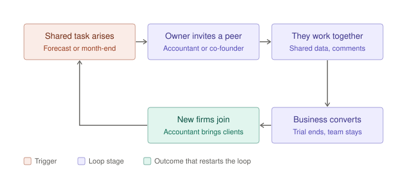

# The Bet · FinWise

> Module 1 · Ignite a PLG Motion. The growth hypothesis and where you're betting, plus the growth-loop visualization.

## Growth hypothesis

FinWise's biggest growth problem is that trial-to-paid conversion has been stuck at ~2% for 13 straight months, because using the product during the trial isn't turning into a reason to pay.

_Working notes: My first hunch was that users don't see the value and so don't convert, and that conversion had dropped over the year. The data supports half of that. Evidence: trial → paid is the biggest drop-off in the funnel. 98% of trials (6,296 of 6,424) don't convert, and the rate held between 1.87% and 2.08% every month from Oct 2023 to Oct 2024. Against the data: conversion didn't drop, it has been flat. And more trial users imported data (~40% → ~44%) and used modeling (~20% → ~49%) over the year, yet conversion didn't move, so product use alone isn't what drives paying. FinWise runs a reverse trial, so trial users already get full access. The question is what makes them pay, not whether they can see the features. (Assumes the Import Data and Modeling columns measure trial-user behavior; definitions not confirmed.)_

_____

## The bet

Trial → paid (Revenue stage): find the trial action that actually predicts paying, and get trial users there in their first week, to lift conversion from 2% to 3%.

**Not doing:** changing pricing or packaging (Module 6), spending more on acquisition or top-of-funnel, building new premium features.

_____

## Growth loop

**Loop type:** Collaboration, user-invites-user

_____
