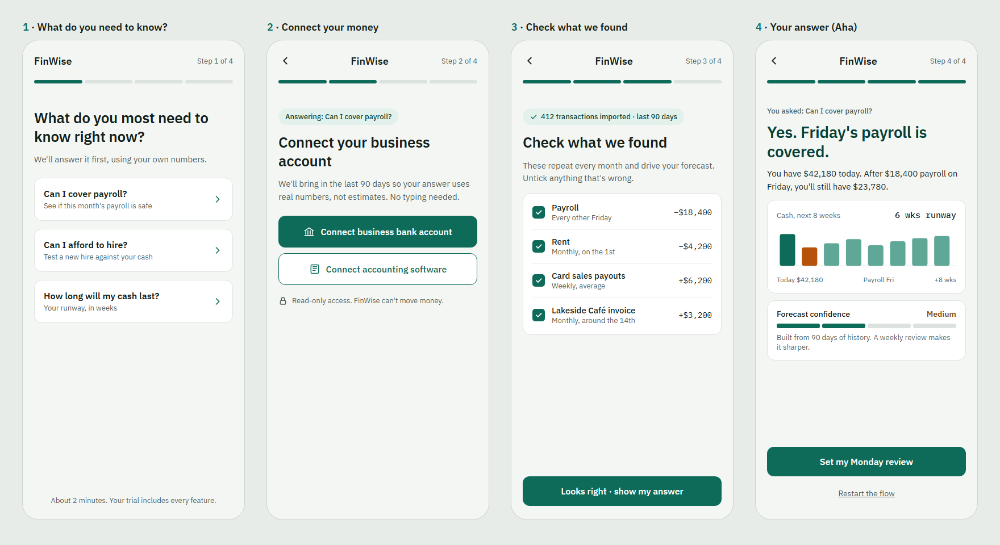

# The Solution · FinWise

> Module 2 · Acquisition & Activation. The onboarding solution and the Aha moment that makes value land.

## Aha moment

The first time a trial user gets a cash answer they trust, built from their own data, for example *"Yes. Friday's payroll is covered. After $18,400 payroll, you'll still have $23,780."*

Why this and not something simpler: Import Data % and Modeling % both rose over the year while trial → paid stayed flat at ~2%, so "imported data" or "opened the forecast" can't be the Aha. Users already do both and still leave. What's missing is an answer to a real decision.

_____

## Onboarding prototype

[Clickable onboarding prototype](https://claude.ai/artifact/NQL1KHBo1K1i2e4mPmoanA): sign-up to Aha in 4 screens.

| # | Screen | Its single job | The one action |
|---|---|---|---|
| 1 | What do you need to know? | Decide which question the forecast answers (one-question personalization quiz) | Pick: cover payroll / afford a hire / how long cash lasts |
| 2 | Connect your money | Get real data in, no manual entry | Connect bank or accounting software (90 days pre-filled) |
| 3 | Check what we found | Make the forecast trustworthy | Confirm pre-detected recurring items with one "Looks right" |
| 4 | Your answer (Aha) | Answer the question from screen 1 | "Set my Monday review", the Module 3 trigger |

Removed because they don't move users toward the Aha: profile setup, product tour, budget categories, team invites (moved after the Aha), pricing screens (reverse trial already gives full access). Fallback for users who can't connect yet: a rough estimate from three numbers, with forecast confidence starting at "Low". Sample business data is illustrative.

_____

## Why this activates

What changes: today trial users get access to everything but no answer. This flow is built backwards from one decision the owner already cares about, so the first session ends with an answer instead of an empty dashboard. Pre-filled data (90 days of history, auto-detected recurring items) turns setup into confirming, which keeps time-to-Aha to a few minutes in the first session.

Why it should convert: an owner who sees their own payroll or hiring question answered correctly has felt the value that's worth paying for, not just seen features. The answer arrives with forecast confidence at "Medium", which feeds straight into the Module 3 habit loop: each weekly review makes the forecast more trustworthy, building value the user would lose at the end of the reverse trial.

_To validate (Module 4): share of signups reaching screen 4, time to reach it, and whether users who reach it convert above the ~2% baseline. The Aha definition is a hypothesis until that data exists._

_____
