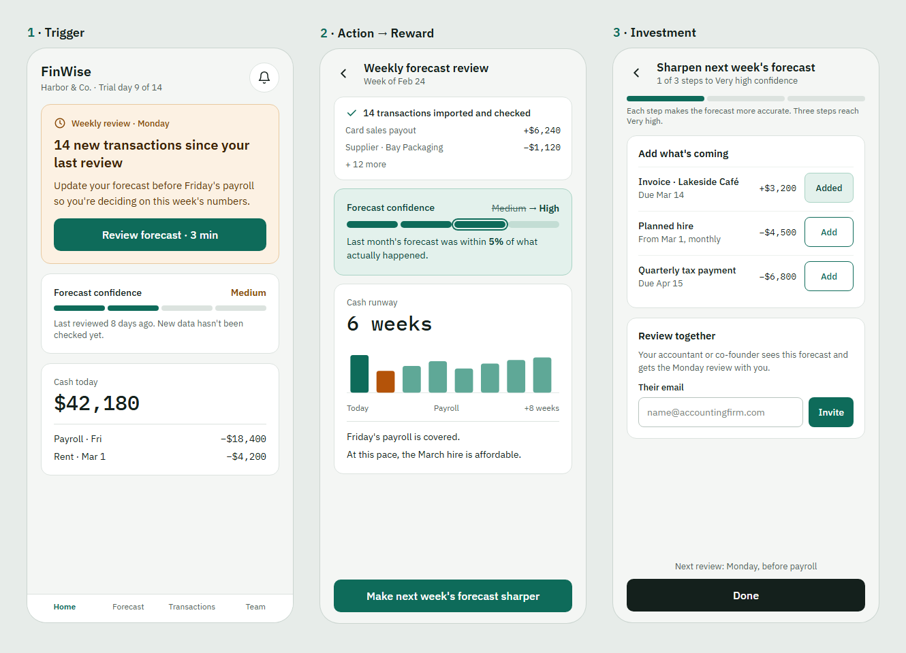

# The Mechanic · FinWise

> Module 3 · Retention & Engagement. The engagement mechanic that builds the habit loop, with rationale and a wireframe.

## The mechanic

**Mechanic:** Progress Bar, a forecast confidence meter

- **Trigger:** Monday notification when new transactions come in: "14 new transactions, update your forecast before Friday's payroll."
- **Action:** Import the latest transactions and review the cash forecast.
- **Reward:** Confidence moves up (Medium → High) and they get an answer, like "6 weeks of runway, payroll is covered."
- **Investment:** Add upcoming invoices or a planned hire, or invite their accountant.

_____

## Rationale

This addresses value-related churn: modeling usage went up but sessions dropped from 11.5 to 9.3 min and churn rose, so users try the forecast but don't get an answer they trust. A user about to churn would stay because each week the forecast gets more accurate and answers a real question, which they'd lose at the end of the reverse trial.

_____

## Wireframe

[Clickable wireframe](https://claude.ai/artifact/8FCBDDiyfDqVp3nJPMCzZq): trigger, weekly review, and investment screens.

_____
